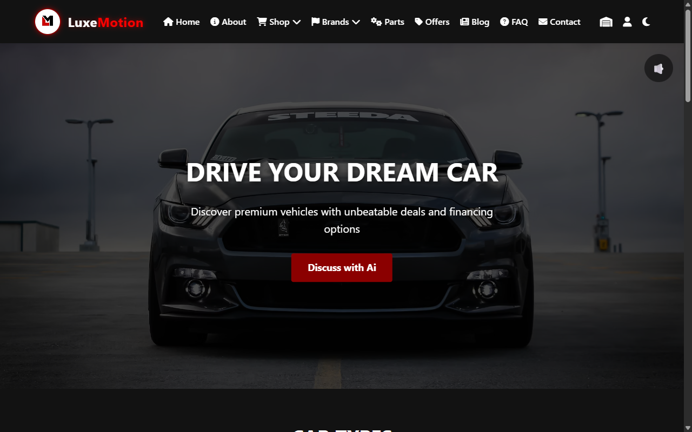
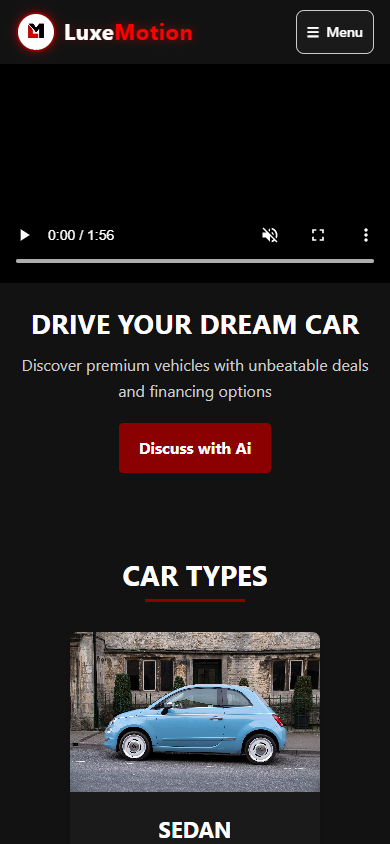

# LuxeMotion – Premium Car Dealership Website

A responsive multi-page website for a premium car dealership, with brand pages, a car shop, news and an AI assistant page.

**Live Demo:** https://kaungzawhan830-byte.github.io/luxemotion-car-website/

## Screenshots

| Desktop | Mobile |
|---|---|
|  |  |

## Features

- Home, Car Shop, New Arrivals, Offers, FAQ, Maintenance, Industry News, Sign Up and AI Assistant pages
- Brand pages for BMW, Toyota, Honda, German and Japanese cars
- Background and promo videos
- Responsive layout with mobile menu (`mobile.css` / `mobile.js`)

## Technologies

HTML5, CSS3, JavaScript

## Run Locally

No build step needed. Download the repository and open `index.html` (or `H2.html`) in any browser.
